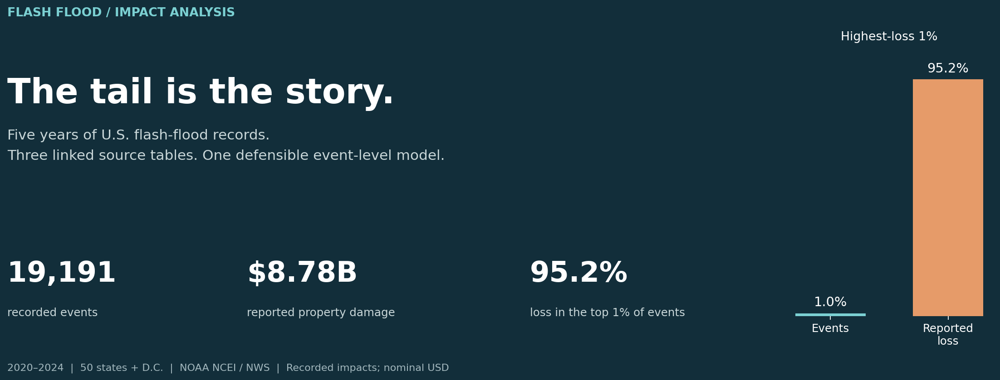
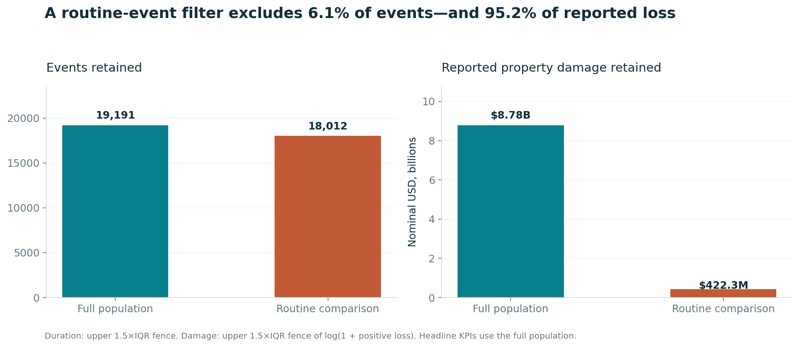
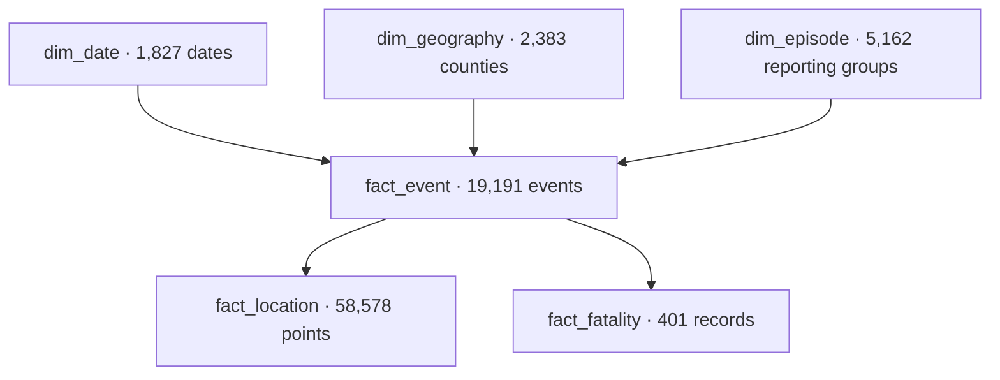

# Flash-Flood Impacts: Where the Losses Concentrate

**19,191 events. Three linked NOAA tables. A 4.92× aggregation error avoided before the first KPI.**



An end-to-end analysis of recorded U.S. flash-flood impacts from **2020–2024**, built to answer a practical question: **where should an operations review start when event volume, financial impact, and human impact point in different directions?**

The result is a reproducible analytical model, 12 SQL analyses, an interactive browser report, and a documented set of data decisions. The analysis uses public observations rather than simulated business results. It does not claim an implemented intervention or a measured reduction in losses.

**Python · pandas · SQL / SQLite · relational modeling · data validation · Matplotlib · browser reporting**

**Explore:** [Decision memo](reports/decision_memo.md) · [Analysis notebook](notebooks/01_flash_flood_analysis.ipynb) · [SQL](sql/) · [KPI definitions](docs/metric_dictionary.md) · [Data quality decisions](docs/data_quality.md)

For interactive filters and CSV export, download [the browser report](reports/flash_flood_report.html) and open the HTML file. It runs without Python, an account, or an internet connection. GitHub's file viewer displays HTML source rather than running the report.

## The findings

| Finding | Evidence | Operational implication |
|---|---|---|
| Loss is concentrated in a small tail | The highest-loss **192 events**, 1% of the population rounded up, account for **95.2%** of reported property damage | Review high-impact episodes separately from routine event activity; the average event is a poor planning unit |
| Record volume and impact differ | Texas has the most recorded events (**1,504**); North Carolina has the largest reported property-damage total (**$2.16B**) | Show volume, financial impact, and casualties together; avoid a single composite ranking |
| Overnight starts have a different casualty profile | **28.8%** of event records begin overnight; those records account for **53.0%** of reported direct deaths | Investigate the pattern with geography, severity, and exposure data before proposing an intervention |
| A populated damage field can still be ambiguous | **70.2%** of events explicitly record zero property damage; **46.3%** of events with a reported direct casualty also record zero property damage | Display reporting context beside loss totals; do not recode zero to missing or treat it as verified absence of loss |
| Location linkage varies by year | Events with at least one valid linked location decline from **98.0% in 2020** to **57.0% in 2024** | Check spatial coverage before comparing maps; this is not proof that the event-details coordinates are absent |
| Two tables disagree on a casualty count | Event **970467** has zero direct deaths in its event summary and two direct-fatality records | Keep the discrepancy explicit, preserve both sources, and define which table supplies each metric |

These are descriptive findings about the frozen source snapshot. They are not causal estimates or rankings of underlying flood risk.

## The scorecard

### Core impact KPIs

| Metric | Result | Definition |
|---|---:|---|
| Recorded flash-flood events | **19,191** | Distinct event IDs in scope |
| Recorded episode IDs | **5,162** | Distinct NOAA reporting groups represented by those events |
| Counties / equivalents with a record | **2,383** | Distinct state + county identifiers; not the total U.S. county denominator |
| Reported property damage | **$8,780,404,020** | Sum of event-level property-damage estimates, nominal USD |
| Reported crop damage | **$233,427,000** | Separately summed event-level crop-damage estimates |
| Reported direct deaths | **389** | Sum of the event-summary direct-death field |
| Reported indirect deaths | **10** | Kept separate from direct deaths |
| Reported direct injuries | **93** | Sum of event-summary direct injuries |
| Median recorded event duration | **2.0 hours** | All events with a nonnegative, parseable duration |
| 90th percentile duration | **5.1 hours** | Full-population empirical 90th percentile |

### Diagnostics that headline totals miss

| Metric | Result | Why it changes the interpretation |
|---|---:|---|
| Highest-loss 1% event share | **95.2% of reported property damage** | Measures impact concentration rather than frequency |
| Highest-loss 1% episode share | **93.2% of reported property damage** | Tests whether concentration remains at reporting-group grain |
| Median positive property-damage entry | **$10,000** | A typical positive entry is far below the **$1.54M mean** among positive entries |
| Overnight fatal-event proportion | **1.79% vs. 0.72%** | Events with at least one reported direct death; **2.47×** unadjusted ratio |
| Valid linked-location coverage | **70.3% of events** | The denominator is events, not the 58,578 child location rows |
| Direct-casualty events with zero reported property damage | **101 of 218; 46.3%** | Makes ambiguity visible in a high-impact subset |
| Vehicle / trailer share of direct-fatality records | **29.7% of all direct records; 34.8% of known-location records** | Keeps the effect of an unknown context denominator visible |
| Routine-filter sensitivity | **6.1% of events excluded; 95.2% of reported loss excluded** | Shows why routine-event cleaning cannot stand in for impact accounting |

Detailed formulas, denominators, populations, and implementation links are in the [metric dictionary](docs/metric_dictionary.md). Machine-readable results are in [reports/tables](reports/tables/).

## The most consequential technical decision: preserve event grain

The source is relational. One event can have several location records and several fatality records. Joining both child tables directly to the event table multiplies rows. A later `SUM(property_damage)` then repeats the same loss across that product.

In this snapshot, the naïve join expands **19,191 event records to 64,795 rows** and inflates reported property damage from **$8.78B to $43.17B**. `COUNT(DISTINCT event_id)` would repair a count while leaving the financial error intact.

The production view aggregates each child table before joining:

```sql
WITH locations AS (
    SELECT event_id, COUNT(*) AS location_records
    FROM fact_location
    GROUP BY event_id
), fatalities AS (
    SELECT event_id, COUNT(*) AS fatality_records
    FROM fact_fatality
    GROUP BY event_id
)
SELECT e.event_id, e.property_damage_usd,
       COALESCE(l.location_records, 0) AS location_records,
       COALESCE(f.fatality_records, 0) AS fatality_records
FROM fact_event e
LEFT JOIN locations l USING (event_id)
LEFT JOIN fatalities f USING (event_id);
```

The resulting view has exactly one row per event. Row count, damage totals, and casualty totals are checked independently. The full implementation is in [00_schema.sql](sql/00_schema.sql).

## The data

**Publisher:** NOAA National Centers for Environmental Information / National Weather Service. **Study period:** January 1, 2020–December 31, 2024. **Geography:** 50 U.S. states and Washington, D.C. Territories remain in the raw extracts and are excluded by an explicit scope rule.

| Source table | Source grain | Flash-flood extract rows | In-scope model rows |
|---|---|---:|---:|
| Event details | One event ID | 19,749 | 19,191 |
| Locations | One event ID + location index | 60,295 | 58,578 |
| Fatalities | One fatality ID | 408 | 401 |

Five yearly files per table yield **15 source snapshots**. Original source URLs, file versions, full-download checksums, extracted-file checksums, and extraction counts are recorded in [sources.lock.json](data/sources.lock.json).

The committed raw extracts retain the original cell strings and columns. Extraction applies only the `Flash Flood` event-type filter and linked-event-ID selection. Full all-hazard downloads are optional, cached locally, and excluded from Git tracking. This keeps the repository reviewable without making the analysis dependent on a live API.

**Primary references:** [bulk files](https://www.ncei.noaa.gov/pub/data/swdi/stormevents/csvfiles/) · [field definitions](https://www.ncei.noaa.gov/pub/data/swdi/stormevents/csvfiles/Storm-Data-Bulk-csv-Format.pdf) · [source-version conventions](https://www.ncei.noaa.gov/pub/data/swdi/stormevents/csvfiles/README) · [NOAA/NWS use terms](https://www.weather.gov/disclaimer)

## Cleaning and outliers

The pipeline preserves source evidence and separates corrections, scope exclusions, unresolved issues, and statistical filters.

1. **Verify inputs.** SHA-256 checks reject changed raw extracts.
2. **Apply scope.** Exclude 558 territory event records and their 1,724 linked child records. This is a study boundary, not an error-removal claim.
3. **Enforce keys.** Remove exact business-row duplicates; quarantine all conflicting versions of a primary key. Neither condition occurs in this snapshot. The rules are covered by adversarial unit cases.
4. **Type and validate.** Parse dates, nonnegative casualty counts, coordinate ranges, and damage suffixes. Preserve raw tokens and maintain separate `zero`, `positive`, `missing`, and `invalid` damage statuses. No malformed damage token or impossible coordinate is found in this snapshot.
5. **Retain unresolved records.** Keep 1,269 zero-duration events and flag nine durations above 72 hours for review. Their narratives do not justify silently rewriting the timestamps. Forty-three missing event narratives remain missing.
6. **Flag statistical tails.** The upper duration fence is **6 hours**. The upper damage fence is **$3.40M**, calculated on `log(1 + positive property damage)`. The fixed full-study thresholds are used in every filter state.
7. **Create two populations.** `vw_event_enriched` preserves the full accounting population. `vw_routine_event` excludes flagged tails and unknown durations for routine comparisons. Every excluded event is listed with its source row.



| Population | Events | Reported property damage | Mean recorded duration |
|---|---:|---:|---:|
| Full population | 19,191 | $8,780,404,020 | 2.65 hours |
| Duration outliers removed | 18,105 | $3,544,687,870 | 2.09 hours |
| Damage outliers removed | 19,031 | $507,754,020 | 2.60 hours |
| Routine comparison | 18,012 | $422,277,870 | 2.08 hours |

A statistical outlier is not an established data error. Extreme reported losses stay in every headline impact measure. [The quality report](docs/data_quality.md) records the policy and the unresolved casualty discrepancy.

## Analytical model



The database has primary keys, foreign keys, nonnegative-value constraints, indexes for common joins, and a separate row-level `data_issue` audit table. [The data dictionary](docs/data_dictionary.md) describes the model fields and their source lineage.

The SQL covers impact totals, a complete 60-month calendar spine, year-over-year comparisons with `LAG`, state and county profiles, ranked loss concentration, overnight-start profiles, fatality context, cross-table reconciliation, reporting diagnostics, outlier sensitivity, episode impacts, and month/hour seasonality.

## Reproduce the analysis

Python **3.12** is the validated runtime. The committed source extracts make the default run offline after dependencies are installed.

```bash
python -m venv .venv
# Windows PowerShell: .venv\Scripts\Activate.ps1
# macOS / Linux: source .venv/bin/activate
python -m pip install -r requirements.txt
python run_pipeline.py
python -m unittest discover -s tests -v
```

The pipeline builds the SQLite database, exports typed model tables and SQL results, creates PNG/SVG figures, and renders the self-contained browser report. To retrieve the original full-source files again:

```bash
python scripts/download_data.py
```

Existing URLs and hashes are reused. A changed upstream source fails verification instead of silently changing the study. An intentional `--refresh-lock` discovers new versions and requires reviewing the resulting changes.

The [analysis notebook](notebooks/01_flash_flood_analysis.ipynb) presents executed SQL and pandas outputs. It reads the built model; the pipeline remains the single implementation of cleaning and modeling.

## Validation

**13 automated tests pass** on this source snapshot, supplemented by cross-checks executed during analysis:

- Raw extract hashes, primary-key uniqueness, SQLite integrity, and foreign-key integrity.
- Independently reconciled SQL and pandas event counts, property damage, and direct-death totals.
- Monthly and state aggregates reconcile to the full population; the top-1% concentration is independently recalculated.
- Known casualty-table disagreement is tested explicitly, so a future source change cannot erase it unnoticed.
- Routine-view filtering is tested separately from the full impact population.
- Damage parsing covers decimal suffixes, zero versus missing, malformed tokens, and negative values.
- Duplicate and conflicting-key cases verify that conflicting versions are quarantined rather than arbitrarily selected.

The browser-report calculation and control logic is also checked with a dependency-free simulated-DOM harness: `node scripts/validate_report.js`. It covers year, state, and routine-population filters; search; reset; and CSV export. This is a logic check, not a claim of browser layout testing.

The [GitHub Actions workflow](.github/workflows/validate.yml) rebuilds the study and runs the tests on pushes and pull requests. No API key or external data download is required for that workflow.

## Repository map

| Path | Purpose |
|---|---|
| `data/raw/` | Frozen study extracts; original cell values |
| `data/sources.lock.json` | Source versions, URLs, checksums, and row counts |
| `src/floodfolio/` | Cleaning, model build, analysis, and reporting code |
| `sql/` | Schema, protected event-grain view, and 12 analyses |
| `notebooks/` | Executed analytical walkthrough |
| `reports/flash_flood_report.html` | Portable interactive report |
| `reports/tables/` | KPI results, sensitivity outputs, exclusions, and audit records |
| `reports/figures/` | Publication-ready PNG and SVG charts |
| `docs/` | Metric definitions, model dictionary, quality decisions, and limitations |
| `tests/` | Cleaning and data-contract tests |

## Boundaries and next decisions

This is an impact and reporting analysis, not a prediction of future flooding. The records reflect reporting practices as well as actual events. Damage figures are broad estimates in nominal dollars; they are not verified insurance losses. Zero entries do not distinguish no damage from unquantified damage. County event records are not unique nationwide storms, and episode IDs should not be interpreted that way either.

The overnight comparison uses **20:00–05:59 in the source's reported local time**. It does not calculate astronomical darkness, convert all records to one time zone, or identify the time of death. No claim of causality is made.

A defensible next phase would add population and asset exposure, rainfall severity, warning records, and response or closure logs. Those inputs could test whether the recorded patterns persist after adjustment. Until then, the recommendations are to improve reporting controls and target further investigation—not to claim an optimal allocation or an intervention effect.

**Attribution:** NOAA NCEI / NWS source material is public-domain U.S. government information unless otherwise noted. It is not covered by the repository's code license. This independent project is not endorsed by NOAA or NWS. See [NOTICE](NOTICE) and [LICENSE](LICENSE).
